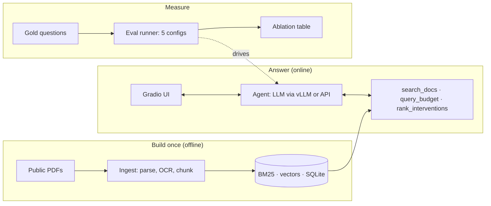

# Bajeti Copilot

[](https://github.com/MoshiG/bajeti-copilot/actions/workflows/ci.yml)

A question-answering copilot over Tanzania's public budget documents, built to be evaluated.
It answers in **Swahili or English**, cites the **document and page** behind its claims, uses
SQL over extracted budget tables for figures, and replies with a fixed "not found" message when
the documents do not contain the answer.

The project is designed around measurement: a five-step ablation isolates what each component
contributes, and guardrail failures (invented citations, unverified figures, wrong refusals) are
counted, not just prevented.

> **Status:** the pipeline, guardrails and evaluation harness are complete and tested. The gold
> question set is being written ([`eval/gold.jsonl`](eval/gold.jsonl): drafted questions, answers
> to be filled from the PDFs), so **no results are reported yet**.

> **Not official advice.** Built on public Ministry of Finance documents for research and
> demonstration. Always check figures in the cited document.

## What it does

- **Ask in either language.** "Wizara ya Afya imetengewa kiasi gani 2025/26?" or "How did Vote 52
  change between 2025/26 and 2026/27?"
- **Three tools, chosen by the model:**
  - `search_docs`: hybrid retrieval over speeches, Finance Acts and estimates, filterable by year,
    document type and language
  - `query_budget`: read-only SQL over budget tables extracted from the estimates
  - `rank_interventions`: exact optimiser that picks interventions under a budget ceiling
- **Checked citations and visible warnings:** invented citation ids are removed, and the demo
  warns when an answer is uncited or contains money figures that appear nowhere in the evidence.

## Architecture



| Stage | What happens | Code |
|---|---|---|
| Corpus | 14 documents listed with their sources (see [Data](#data)); SHA-256 lock file | `data/corpus.yaml`, `corpus.py` |
| Parsing | Page numbers kept, running headers removed, headings detected, tables extracted intact, OCR for scans | `ingest/parse.py` |
| Budget estimates | Layout-specific parser for the Volume IV development estimates: every project, sub-vote and vote, checked against the totals printed in the document | `ingest/estimates.py` |
| Chunking | *Naive* fixed windows vs *structured* chunks that follow sections and keep tables whole | `ingest/chunk.py` |
| Indexes | BM25 (exact terms like "Fungu 46"), bge-m3 vectors (meaning, cross-lingual), SQLite budget tables | `index/` |
| Retrieval | BM25 + dense fused with reciprocal rank fusion, then a cross-encoder reranker | `retrieval.py` |
| Agent | Tool-calling loop with citation checks, refusals and a figure check | `agent.py`, `tools.py` |
| Evaluation | Retrieval and answer metrics with 95% intervals; optional LLM judge, validated against human labels | `evaluation/` |

## Results

> **Pending.** Produced by `make eval` on the test split of the gold set and copied from
> `eval/results/ablation.md`. Columns below are exactly those the harness generates.

| Config | Chunking | BM25 | Dense | Rerank | Tools | Hit@1 | Hit@6 | MRR | Correct, answerable (95% CI) | Citation hit | Invented cites | Unverified figs | Refusal acc | False refusals | Avg s |
|---|---|---|---|---|---|---|---|---|---|---|---|---|---|---|---|
| a1_naive_dense | naive | | ✓ | | search only | | | | | | | | | | |
| a2_hybrid | naive | ✓ | ✓ | | search only | | | | | | | | | | |
| a3_hybrid_rerank | naive | ✓ | ✓ | ✓ | search only | | | | | | | | | | |
| a4_structured | structured | ✓ | ✓ | ✓ | search only | | | | | | | | | | |
| a5_full | structured | ✓ | ✓ | ✓ | SQL+opt | | | | | | | | | | |

When run with `--judge`, a further column reports the share of answers whose every claim the
judge found supported, alongside the judge's agreement with human labels.

### Error analysis

> **Pending.** Each evaluation record says whether a miss was *never retrieved*, *retrieved but
> ranked out of the top 6*, or *retrieved but answered wrongly*.

### Extraction accuracy

The Volume IV estimates have no ruling lines, so general table extraction misses them. A
layout-specific parser reads them from word positions, and its output is checked against the
totals the Ministry printed:

| Document | Projects | Sub-vote totals reconciled | Vote totals reconciled | Vote summary rows adding up |
|---|---|---|---|---|
| Volume IV 2025/26 | 3,248 | 758 / 758 | 85 / 85 | 95 / 95 |
| Volume IV 2026/27 | 3,295 | 857 / 857 | 85 / 85 | 104 / 104 |

`make ingest` reprints this check on every run.

## Guardrails

| Risk | Guardrail | Enforced by |
|---|---|---|
| Model changes data | Read-only SQLite connection; single SELECT (string contents and comments ignored when checking); keyword blocklist; 5-second timeout; 100-row cap | code |
| Invented citations | Every `[S#]` (including grouped `[S1, S2]`) is checked against what tools returned; unknown ids are removed and counted | code |
| Uncited answers | If tools returned evidence but the answer cites none, one repair turn; if still uncited, flagged and shown with a warning | code |
| Misquoted figures | Every money figure in an answer must match a tool result at some unit scale, or it is flagged as unverified (percentages and labels like "Section 117" are not checked) | code |
| Answering outside the documents | A fixed refusal phrase in Swahili or English, scored on unanswerable gold questions | prompt + measured |
| Mental arithmetic | The model is instructed to use `query_budget` for figures and totals | prompt |
| Runaway agent | At most 5 tool rounds; bad tool calls become messages the model can correct; repeated calls are cached | code |
| Stale vectors | The dense index refuses to load if the chunks or embedding model changed | code |
| Mixed evaluation runs | `--resume` refuses runs with different settings or models, and re-asks edited gold questions | code |
| Public demo abuse | 1,000-character question limit; per-visitor rate limit (10 per 10 minutes); request queue; questions not stored | code |

### Known limitations

- **A valid citation does not prove support.** Citations are checked to exist, not to support the
  sentence. The optional LLM judge measures support at evaluation time; its agreement with human
  labels is reported by `bajeti judge-validate`.
- **The figure check is lenient on units.** It accepts any power-of-1,000 scale, so it catches
  figures found nowhere in the evidence but cannot prove a unit is right; against tables with
  many figures, a wrong amount can match by coincidence.
- **Refusals are detected by an exact phrase.** A model that declines in other words is counted
  as not refusing, which lowers refusal accuracy and can also hide false refusals.
- **Table extraction depends on PDF layout.** The Volume IV parser is specific to that
  document's layout and is verified against its printed totals; tables inside the speeches use
  general extraction, which can miss tables drawn without ruling lines. Units are read from
  header rows only. `raw_cells` keeps every extracted cell for inspection.
- **Two tables can define a figure differently.** For regional (RAS) votes, the Volume IV
  vote summary and the project pages count transfers to local government authorities
  differently, so a vote's "development budget" depends on the table; answers say which.
- **Retrieved text is not sanitised against instructions embedded in documents.** The risk is low
  for official PDFs, and every tool is read-only.
- **Judge claims are not independent.** Claims from the same answer are correlated, so judge
  results are summarised per answer.

## Quick start

```bash
make install                                   # core, PDF parsing, BM25 (no PyTorch)
sudo apt install tesseract-ocr tesseract-ocr-swa
make test                                      # offline: no GPU, model or API key needed

make fetch && make ingest                      # download and parse the corpus
make index-smoke                               # CPU pipeline check with hashing vectors
```

Three documents (the 2024/25 Swahili and 2025/26 speeches) have no stable download link;
`make fetch` prints where to get each one and the filename to save it as.

On a GPU machine, for real embeddings and a local model:

```bash
pip install -e ".[all]"
make index                                     # bge-m3 embeddings + budget database
vllm serve Qwen/Qwen2.5-7B-Instruct --enable-auto-tool-choice --tool-call-parser hermes
make ping                                      # check the endpoint answers
bajeti ask "Wizara ya Afya imetengewa kiasi gani 2025/26?" --trace
make demo                                      # http://127.0.0.1:7860
```

Any OpenAI-compatible endpoint works: set `BAJETI_LLM_BASE_URL`, `BAJETI_LLM_MODEL` and
`BAJETI_API_KEY`.

### Evaluation

Configuration files (`-c`) go before the command and layer in order.

```bash
bajeti gold-check                              # validate the gold questions
make eval-retrieval                            # retrieval metrics, all configs, no LLM (needs .[embed])
make eval                                      # full ablation on the test split (resumable)

# Faithfulness: first uncomment and fill the `judge:` section in configs/default.yaml
bajeti -c configs/default.yaml -c configs/ablations/a5_full.yaml eval --split test --judge
bajeti export-claims -n 30                     # sample claims from a5_full to label by hand
bajeti judge-validate                          # judge vs. your labels: agreement, Cohen's kappa
```

See [`eval/GOLD_GUIDE.md`](eval/GOLD_GUIDE.md) for how the gold questions are written.

### Docker

```bash
docker build -t bajeti-copilot .
docker run -p 7860:7860 -v "$(pwd)/data:/app/data" \
  -e BAJETI_LLM_BASE_URL=... -e BAJETI_LLM_MODEL=... -e BAJETI_API_KEY=... bajeti-copilot
```

The image runs on CPU. The embedding and reranker models download on first start, and reranking
on CPU adds a few seconds per question; lower `retrieval.candidates` for a faster demo.

## Reproducibility

- Every downloaded document's source and SHA-256 are recorded in `data/raw/manifest.lock.json`,
  which is committed.
- Each ablation row is a few lines of YAML in `configs/ablations/`, layered over
  `configs/default.yaml`.
- Evaluation summaries record the models that actually ran (including overrides), the judge
  model and the settings; every answer is saved with its citations and retrieval diagnosis.
- Temperature is 0 and answer scoring is deterministic.

## Repository layout

```
configs/            default settings and the five ablation overlays
data/corpus.yaml    the corpus manifest (documents are downloaded, never committed)
eval/               gold questions, writing guide, results
src/bajeti/         ingest/, index/, retrieval.py, tools.py, agent.py, evaluation/, app.py
tests/              unit and end-to-end tests on a synthetic budget-speech PDF
```

## Data

| Type | Fiscal years |
|---|---|
| Budget speeches | 2018/19 (sw), 2019/20 (sw, en), 2020/21 (en), 2021/22 (sw, en), 2024/25 (sw, en), 2025/26 (sw, en) |
| Finance Acts | 2021, 2025 |
| Development estimates (Volume IV) | 2025/26, 2026/27 |

The corpus does not yet include the 2022/23 and 2023/24 speeches; questions about those years
should be treated as unanswerable until they are added to `data/corpus.yaml`.

Documents are published by the Ministry of Finance of the United Republic of Tanzania
([mof.go.tz](https://www.mof.go.tz), [repository.mof.go.tz](https://repository.mof.go.tz)) and
TanzLII and the Parliament of Tanzania ([parliament.go.tz](https://www.parliament.go.tz)). They are downloaded from their official sources and are not redistributed here.

## License

Code is released under the MIT License. The documents remain subject to their publishers' terms.
